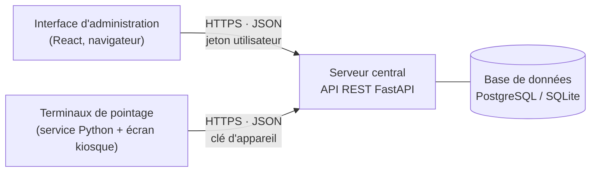
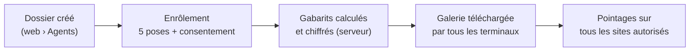
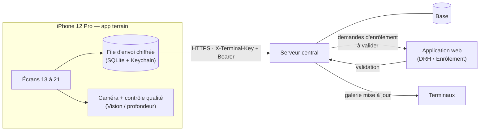

# Application mobile terrain (iPhone) — fonctionnement et intégration

> **État au 31/10/2026 : réalisé.** L'application est dans `mobile/` (React Native + Expo SDK 58,
> TypeScript) et les points d'accès « à ajouter » décrits ci-dessous existent désormais côté serveur
> (`server/app/routers/mobile.py`, `server/app/routers/enrolements.py`), avec l'onglet « À valider »
> de l'écran web Enrôlement et 8 tests automatisés (`tests/test_mobile.py`).
> Choix retenus : droit **« Proposer un enrôlement (mobile) »** pour les responsables dans leur
> périmètre, validation réservée à la DRH et à l'administrateur ; pour le **pointage de secours**,
> la reconnaissance est faite **par le serveur** (Expo Go ne permet pas d'exécuter SFace sur le
> téléphone) : sans réseau, la photo attend dans la file d'envoi et l'agent est reconnu à l'envoi,
> avec l'heure réelle du pointage. Le contrôle qualité des photos se fait par l'analyse du serveur
> après chaque prise (sans réseau, il est fait à la réception). La reconnaissance sur le téléphone
> et la mesure de profondeur (§ 6) restent des évolutions nécessitant une version compilée.

Ce document explique comment fonctionne l'application web actuelle, puis comment l'application
mobile des maquettes (écrans 13 à 21) doit communiquer avec elle et avec la base de données.
Il précise, pour chaque besoin, **ce qui existe déjà** dans le serveur et **ce qu'il faut ajouter**.

Appareil visé : **iPhone 12 Pro** (iOS 17 ou plus). Il dispose d'une caméra arrière 12 Mpx avec
**capteur LiDAR** et d'une caméra avant **TrueDepth** (celle de Face ID), toutes deux capables de
mesurer la profondeur. C'est un atout pour l'anti-fraude (voir § 6).

---

## 1. Ce que montrent les maquettes mobiles

| N° | Écran | Rôle |
|---|---|---|
| 13 | Connexion | Matricule + mot de passe ; « Appareil enregistré · MOB-BKO-07 » ; seuls les appareils enregistrés par l'administrateur peuvent enrôler ou pointer |
| 14 | Accueil | Utilisateur et périmètre, site et état réseau de l'appareil, deux actions (Enrôler un agent, Pointage de secours), activité récente avec statuts (En validation, Synchronisé, En attente) |
| 15 | Enrôlement · 1/3 | Recherche par matricule ou nom ; seuls les agents **sans visage enrôlé** sont proposés ; le dossier est créé dans l'application web |
| 16 | Enrôlement · 2/3 | Capture des 5 poses (face, gauche, droite, haut, bas), contrôle lumière et netteté |
| 17 | Enrôlement · 3/3 | Revue des 5 photos, reprise possible, consentement, « Envoyer au serveur central » |
| 18 | Enrôlement envoyé | Suivi en 3 étapes : reçu par le serveur → calcul du gabarit → **validation par la DRH dans l'application web** |
| 19 | File d'envoi | Réseau indisponible : données **chiffrées sur le téléphone**, envoyées au retour du réseau ; bouton « Envoyer maintenant » |
| 20 | Pointage de secours | Si le terminal du site est en panne ; choix Entrée/Sortie ; chaque pointage est marqué « secours » |
| 21 | Résultat secours | Agent reconnu, heure, site, rattachement, appareil, état de synchronisation, « Ce n'est pas moi » |

Trois principes ressortent des maquettes :

1. **Le téléphone est un appareil enregistré**, au même titre qu'un terminal (`MOB-BKO-07` suit
   la même logique de nommage que `TRM-BKO-03`).
2. **Un enrôlement mobile n'est pas définitif** : il passe par une **validation de la DRH** dans
   l'application web (écran 18).
3. **Le mobile fonctionne hors ligne** : une file d'envoi chiffrée, comme sur les terminaux.

---

## 2. Comment fonctionne l'application web aujourd'hui

### Les trois parties



- **Le serveur central** (`server/`) est le seul composant qui lit et écrit dans la base. Il
  applique les règles métier (droits, périmètres, calcul des présences, unicité des pointages),
  calcule les gabarits faciaux et les chiffre avant de les enregistrer.
- **L'interface d'administration** (`frontend/`) est une application React servie par le serveur.
  Elle ne fait qu'appeler l'API.
- **Les terminaux** (`terminal/`) reconnaissent les visages localement, à partir d'une copie
  chiffrée de la galerie. Ils stockent les pointages dans une file locale et les envoient au serveur.

> **Règle fondamentale : l'application mobile ne se connecte jamais directement à la base de
> données.** Elle passe exclusivement par l'API du serveur central, en HTTPS, comme les deux
> autres clients. C'est ce qui garantit que les droits, le chiffrement et l'audit s'appliquent
> aussi au mobile.

### Les deux façons de s'authentifier auprès de l'API

| Qui | Comment | En-tête HTTP | Où c'est codé |
|---|---|---|---|
| Une **personne** (admin, DRH, responsable) | Identifiant + mot de passe (+ code 2FA éventuel) → jeton de session signé (JWT) | `Authorization: Bearer <jeton>` | `server/app/routers/auth.py`, `securite.py` |
| Un **appareil** (terminal) | Clé d'API individuelle générée dans *Sites et terminaux* ; le serveur n'en garde que l'empreinte SHA-256 | `X-Terminal-Key: <clé>` | `securite.py › terminal_courant` |

**L'application mobile utilisera les deux en même temps**. La clé d'appareil prouve que c'est un
téléphone enregistré (écran 13). Le jeton utilisateur dit qui s'en sert, et donc avec quels droits
et quel périmètre (écran 14 : « Responsable habilité · Service maintenance »).

### Le cycle de vie d'un agent



Aujourd'hui, l'enrôlement se fait sur le poste RH (`/enrolement`). Le navigateur envoie chaque
image au serveur pour une **analyse en direct** (qualité, orientation de la tête), puis les
5 images. Le serveur calcule les gabarits, vérifie la vivacité et l'unicité du visage, les
chiffre, puis **jette les photos** : seules les données chiffrées sont conservées.

---

## 3. Architecture cible avec le mobile



---

## 4. Connexion et enregistrement du téléphone (écrans 13 et 14)

### Enregistrer l'iPhone (une seule fois, par l'administrateur)

1. Dans l'application web, *Sites et terminaux › Enregistrer un terminal* : code `MOB-BKO-07`,
   site « Siège · Bamako ». **Existe déjà.**
2. Le serveur affiche la clé une seule fois. Pour le mobile, il faudra **afficher un QR code**
   contenant `{url_serveur, code_terminal, cle_api}`. L'application le scanne au premier
   lancement et range la clé dans le **Keychain iOS**, jamais dans un fichier en clair. *À ajouter
   (affichage du QR code).*
3. Il faut distinguer bornes fixes et téléphones : ajouter un champ `type` (`BORNE` / `MOBILE`) à la
   table `terminaux`. Il servira à afficher l'appareil correctement et à marquer ses pointages
   comme « secours ». *À ajouter.*

### Connecter l'utilisateur

```http
POST /api/auth/connexion                      ← existe
X-Terminal-Key: edmt_…                        ← à exiger pour les connexions mobiles
Content-Type: application/json

{ "identifiant": "resp.sotuba", "mot_de_passe": "…", "rester_connecte": false }
```

Réponse (existe) : `{ "jeton": "…", "session": { "utilisateur": {…, "perimetre": "Maintenance · Centre technique Sotuba"}, "droits": {…} } }`.
Si la double authentification est active : `deux_etapes_requise: true`, puis `POST /api/auth/deux-etapes`.

Pour l'écran 14 (site, « En ligne »), l'app appelle `GET /api/terminal/configuration` avec sa clé
(**existe**). La réponse contient le nom du site, l'identité de l'organisation et les consignes.

---

## 5. Enrôlement depuis l'iPhone (écrans 15 à 18)

### Étape 1 — Chercher l'agent (écran 15) — **existe**

```http
GET /api/agents?q=EDM-009&enrole=false&actif=true&taille=20
Authorization: Bearer <jeton>
```

Réponse : `{ "total": 1, "elements": [{ "id": 42, "matricule": "EDM-009023", "nom_complet": "Awa Doumbia",
"service_nom": "Commercial", "site_rattachement_nom": "DR Kayes", "nb_gabarits": 0, … }] }`.
Le filtre `enrole=false` donne exactement « seuls les agents sans visage enrôlé ». Le périmètre du
responsable s'applique automatiquement côté serveur.

### Étape 2 — Capturer les 5 poses (écran 16)

Deux possibilités pour le contrôle qualité en direct :

| Option | Fonctionnement | Avantages / limites |
|---|---|---|
| **A. Analyse par le serveur** — existe | Envoyer une image réduite toutes les 400 ms à `POST /api/agents/enrolement/analyse` ; la réponse donne luminosité, netteté, nombre de visages, orientation (`lacet`, `tangage`) | Aucun code de vision à écrire sur le téléphone ; **impossible hors ligne**, consomme du réseau |
| **B. Analyse sur le téléphone** — recommandée | Le framework **Apple Vision** (`VNDetectFaceRectanglesRequest`, `VNDetectFaceCaptureQualityRequest`) fournit visage, qualité et angles de la tête (yaw, pitch) | Instantané, **fonctionne hors ligne** (la maquette prévoit la file d'envoi) |

Les règles à appliquer sont celles de l'application web (`frontend/src/admin/pages/Enrolement.tsx`).
Une pose est capturée quand il y a un seul visage, assez grand, correctement éclairé et net, et que
l'orientation correspond à la consigne : rotation d'au moins 12 % par rapport à la pose de face
pour gauche et droite, de 6 % pour haut et bas.

Format des photos : **JPEG, 1280 px de large, qualité 0,85**. Une seule personne dans le cadre,
visage de 30 % de la largeur au moins. Les photos HEIC de l'iPhone doivent être converties en JPEG.

### Étape 3 — Envoyer (écran 17) — **à ajouter**

Le point d'accès existant `POST /api/agents/{id}/enrolement` enregistre **immédiatement et
définitivement**. Il convient au poste RH, mais pas au mobile. Les maquettes exigent une
**validation par la DRH**, et un envoi qui peut partir plus tard depuis la file. Il faut donc un
nouveau circuit :

```http
POST /api/mobile/enrolements
X-Terminal-Key: edmt_…            (appareil enregistré)
Authorization: Bearer <jeton>     (utilisateur, son périmètre)
Content-Type: application/json

{
  "uuid": "8f0c…",                         // créé par le téléphone : un renvoi n'enregistre rien deux fois
  "agent_id": 42,
  "consentement": true,
  "capture_le": "2026-10-31T09:12:04+00:00",
  "images": [ { "pose": "face", "image": "data:image/jpeg;base64,…" }, … 5 poses ],
  "profondeur": { "disponible": true, "relief_mm": 31 }   // facultatif, voir § 6
}
```

Réponse `202 Accepted` : `{ "uuid": "8f0c…", "statut": "RECUE" }`. En cas de renvoi du même
`uuid` : `200` avec le statut courant, sans doublon.

Côté serveur, il faudra créer une table **`demandes_enrolement`** :

| Colonne | Contenu |
|---|---|
| `uuid` (unique) | identifiant créé par le téléphone |
| `agent_id`, `appareil_id`, `auteur_id` | qui, depuis quel appareil, par quel utilisateur |
| `photos_chiffrees` | les 5 photos **chiffrées**, conservées **uniquement le temps de la validation**, puis effacées |
| `gabarits_chiffres` | calculés dès la réception |
| `statut` | `RECUE` → `GABARIT_CALCULE` → `VALIDEE` ou `REJETEE` (+ `motif`) |
| `cree_le`, `traite_par`, `traite_le` | traçabilité, avec une entrée dans le journal d'audit |

### Étape 4 — Suivi (écran 18) et validation dans l'application web — **à ajouter**

- Le téléphone interroge `GET /api/mobile/enrolements/{uuid}` pour afficher les étapes « Reçu par le
  serveur », « Calcul du gabarit », « Validation par la DRH ».
- Dans l'application web, l'écran *Enrôlement* reçoit un onglet **« À valider »** :
  - `GET /api/enrolements/demandes?statut=GABARIT_CALCULE` donne la liste, avec les miniatures et le contrôle de qualité ;
  - `POST /api/enrolements/demandes/{uuid}/valider` exécute les contrôles existants (vivacité, unicité du visage), enregistre les gabarits dans `gabarits_faciaux` et **efface les photos** ;
  - `POST /api/enrolements/demandes/{uuid}/rejeter` enregistre le motif, par exemple « photo floue ».
- Une fois la demande validée, les terminaux reçoivent l'agent à leur synchronisation suivante, sans autre action.

### Question de droits à trancher

Dans les maquettes, c'est **Drissa Sacko, responsable habilité**, qui enrôle depuis le mobile.
Or la matrice des droits (écran *Utilisateurs et droits*, déjà en place) indique « Enrôler les
visages : **Non** » pour ce profil.

La solution cohérente avec l'écran 18 consiste à ajouter un droit **« Proposer un enrôlement
(mobile) »**, accordé aux responsables dans leur périmètre. La **validation** reste réservée à
l'administrateur et à la DRH. Le responsable collecte les photos sur le terrain, la DRH décide.
**C'est à vous de valider ce choix.**

---

## 6. Pointage de secours (écrans 20 et 21)

Le téléphone remplace un terminal en panne. Le plus simple et le plus sûr est qu'il **se comporte
exactement comme un terminal** : il réutilise l'API des terminaux, qui **existe déjà**.

| Besoin | Point d'accès | État |
|---|---|---|
| Galerie des agents (pour reconnaître hors ligne) | `GET /api/terminal/galerie?version=…` | existe |
| Entrée ou sortie ? (dernier pointage, tous sites) | `GET /api/terminal/etat-agent/{matricule}` | existe |
| Envoyer les pointages (idempotent par `uuid`) | `POST /api/terminal/pointages` | existe |
| Fraudes, visages inconnus | `POST /api/terminal/tentatives` | existe |
| « Ce n'est pas moi » | `POST /api/terminal/annulations` | existe |
| Marquer « secours » | colonne `source` (`BORNE` / `SECOURS`) dans `pointages`, déduite du type d'appareil | **à ajouter** |
| Restreindre au cas de panne | refuser le secours si une borne du même site est en ligne (réglable) | **à ajouter** (facultatif) |

**Où se fait la reconnaissance ?** L'écran 19 affiche « Secours · Mariam Cissé · En attente » alors
que le réseau est coupé. Le téléphone connaît donc l'agent sans le serveur : **la reconnaissance
se fait sur l'iPhone**, comme sur les bornes. Il faut pour cela :

- le **même modèle SFace** (`models/face_recognition_sface_2021dec.onnx`), exécuté sur le téléphone
  (ONNX Runtime pour iOS, ou conversion Core ML). Les gabarits doivent être calculés avec
  **exactement le même modèle et le même alignement du visage**, sinon ils ne sont pas comparables
  avec ceux de la galerie ;
- la galerie stockée **chiffrée** sur le téléphone (clé dans le Keychain, protection
  `NSFileProtectionComplete`) ;
- le **seuil** de similarité du serveur (0,42) et la **revérification** de l'identité après le défi.

Si cette charge paraît trop lourde pour un premier prototype, il existe une variante plus simple :
le téléphone envoie la photo au serveur, qui reconnaît l'agent. Mais **elle ne fonctionne pas hors
ligne**, ce qui contredit l'écran 19.

**Anti-fraude avec l'iPhone 12 Pro.** Les caméras de l'iPhone 12 Pro mesurent la profondeur
(TrueDepth à l'avant, LiDAR à l'arrière). Une photo ou un écran sont **plats**, un visage a du
relief (nez en avant des joues). Mesurer ce relief sur la zone du visage est **plus fiable** que
le défi « tourner la tête » des bornes. Il faut prévoir l'envoi de cette mesure (`profondeur` dans
la requête d'enrôlement), et l'utiliser aussi au pointage de secours. Cela demande un module natif
iOS (AVFoundation / ARKit), voir § 8.

---

## 7. File d'envoi hors ligne (écran 19)

Même principe que les terminaux (`terminal/stockage_local.py`) :

1. Chaque action (enrôlement, pointage, tentative, annulation) reçoit **un `uuid` au moment où
   elle a lieu**, sur le téléphone, et part dans une file **SQLite chiffrée**. Les photos sont
   stockées dans des fichiers protégés par iOS et effacées dès l'accusé de réception.
2. Au retour du réseau, ou sur « Envoyer maintenant », la file est vidée **dans l'ordre
   chronologique**. Un élément n'est retiré de la file **qu'après la réponse du serveur**.
3. Le serveur reconnaît un `uuid` déjà reçu et l'ignore sans erreur (« doublons ignorés »). On
   peut donc renvoyer sans risque après une coupure.
4. L'heure enregistrée est **celle du téléphone** au moment du pointage, avec son fuseau (format
   ISO 8601). Le serveur refuse un horodatage en avance de plus de 10 minutes.
5. À chaque échange, le téléphone envoie l'en-tête `X-Terminal-En-Attente: <n>`. L'administrateur
   voit ainsi dans *Sites et terminaux* combien d'éléments attendent sur l'appareil (**existe**).

---

## 8. Technologie recommandée pour l'application iPhone

Il faut un framework, conformément à votre demande. Deux choix sérieux :

| | **React Native + Expo (TypeScript)** — recommandé | **Swift / SwiftUI (natif)** |
|---|---|---|
| Cohérence avec le projet | Même langage et mêmes habitudes que l'administration (React + TypeScript) | Nouveau langage |
| Développer depuis **Linux** | **Oui** : l'app *Expo Go* sur l'iPhone suffit pour la caméra, le Keychain, SQLite et le réseau | **Non** : Xcode exige un Mac |
| Profondeur TrueDepth / LiDAR, ONNX sur le téléphone | Nécessite un module natif et une « development build », compilée sur un Mac ou par le service EAS d'Expo | Accès direct |
| Bibliothèques | `expo-camera`, `expo-secure-store` (Keychain), `expo-sqlite`, `expo-file-system`, `@tanstack/react-query` | AVFoundation, Vision, ARKit, Core ML |

**Démarche conseillée** : commencer en React Native + Expo avec *Expo Go*. Cela suffit pour la
connexion, la recherche, la capture des 5 poses, l'envoi et la file hors ligne. Ensuite, ajouter
le module natif (profondeur, reconnaissance sur le téléphone) pour le pointage de secours.

**À savoir pour l'iPhone :**
- **Installation** : un projet de fin d'études peut tourner sur votre iPhone via Expo Go, sans
  publication sur l'App Store. Une version autonome installée exige un compte Apple Developer
  (gratuit avec des limites : réinstallation tous les 7 jours ; payant pour une diffusion interne).
- **HTTPS** : iOS refuse par défaut les connexions non chiffrées. En production, le serveur doit
  être en HTTPS. En développement, l'iPhone et le PC doivent être sur le **même Wi-Fi**, et le
  serveur démarré avec `HOTE=0.0.0.0 ./run_server.sh`. L'adresse `127.0.0.1` désigne le téléphone
  lui-même, pas votre PC : l'app doit utiliser l'adresse IP du PC, par exemple `http://192.168.1.20:8000`.
- **Permissions** : déclarer l'usage de la caméra (`NSCameraUsageDescription`) avec un texte
  explicite, par exemple « Photographier les agents pour leur enrôlement biométrique ».

---

## 9. Récapitulatif des échanges mobile ↔ serveur

| Écran | Requête | Authentification | État |
|---|---|---|---|
| 13 Connexion | `POST /api/auth/connexion` (+ `/api/auth/deux-etapes`) | clé appareil | existe (clé à exiger pour le mobile) |
| 14 Accueil | `GET /api/terminal/configuration` | clé appareil | existe |
| 15 Recherche | `GET /api/agents?q=…&enrole=false&actif=true` | jeton | existe |
| 16 Capture | `POST /api/agents/enrolement/analyse` (option A) ou analyse sur le téléphone | jeton | existe (option A) |
| 17 Envoi | `POST /api/mobile/enrolements` | clé + jeton | **à ajouter** |
| 18 Suivi | `GET /api/mobile/enrolements/{uuid}` | clé + jeton | **à ajouter** |
| Web · validation | `GET /api/enrolements/demandes`, `POST …/{uuid}/valider` ou `/rejeter` | jeton DRH / admin | **à ajouter** |
| 19 File d'envoi | renvois idempotents des requêtes ci-dessus | — | mécanisme existant (`uuid`) |
| 20 Secours | `GET /api/terminal/galerie`, `GET /api/terminal/etat-agent/{matricule}` | clé appareil | existe |
| 21 Résultat | `POST /api/terminal/pointages`, `/tentatives`, `/annulations` | clé appareil | existe (+ marquage « secours » à ajouter) |

La documentation interactive de toutes les routes existantes est disponible sur
`http://<serveur>:8000/docs` : schémas JSON, exemples et essais directs.

### Changements nécessaires dans la base de données

| Changement | Pourquoi |
|---|---|
| `terminaux.type` (`BORNE` / `MOBILE`) | distinguer les téléphones des bornes fixes |
| `pointages.source` (`BORNE` / `SECOURS`) | « chaque pointage est marqué secours » (écran 20) |
| nouvelle table `demandes_enrolement` | circuit envoi mobile → validation DRH (écran 18) |
| nouveau droit « Proposer un enrôlement (mobile) » | permettre aux responsables d'enrôler sur le terrain, sous validation |

---

## 10. En attendant l'application : la solution immédiate

L'écran d'enrôlement de l'application web est déjà **responsive** et utilise la caméra du
navigateur. Ouvert dans **Safari sur l'iPhone**, il devrait permettre d'enrôler un agent avec la
caméra du téléphone. Condition : que le serveur soit accessible en **HTTPS**, car Safari bloque la
caméra en HTTP hors `localhost`. Cela n'a pas encore été essayé sur un iPhone : à vérifier. Cette
solution n'offre ni la file hors ligne, ni le circuit de validation, ni le pointage de secours,
mais elle permet de tester la capture avec l'iPhone dès maintenant.
