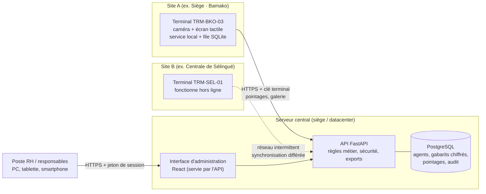
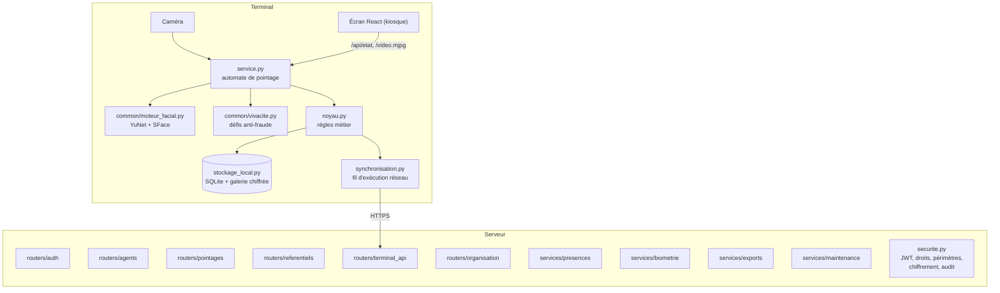
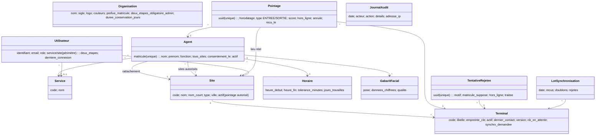
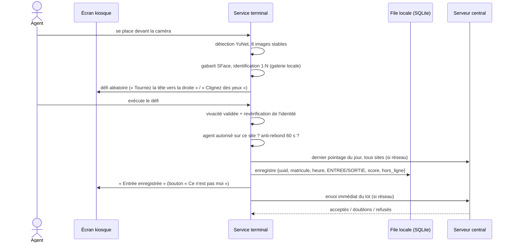
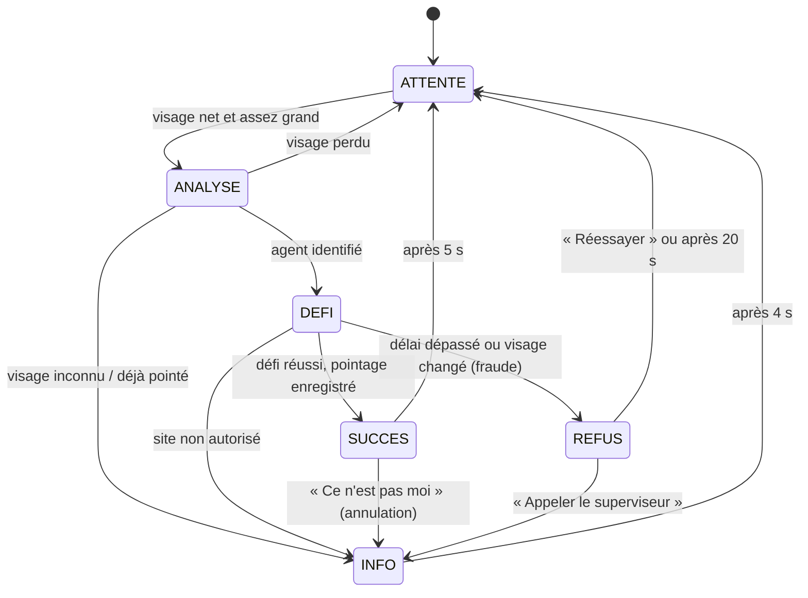

# Architecture, choix techniques et sécurité

Dossier technique du système de pointage biométrique multisite. Il couvre l'analyse des besoins,
l'architecture logicielle et matérielle, les diagrammes de conception, la justification des
technologies et les mesures de protection des données personnelles et biométriques.

## 1. Analyse des besoins

### Acteurs

| Acteur | Rôle |
|---|---|
| Agent | Pointe son entrée et sa sortie sur un terminal, sur n'importe quel site autorisé |
| Administrateur | Gère les sites, terminaux, utilisateurs, paramètres de l'organisation ; accès complet |
| Direction des RH (DRH) | Gère les dossiers agents, enrôle les visages, consulte pointages et rapports, consulte l'audit |
| Responsable habilité | Consulte et gère les agents, pointages et rapports **de son périmètre** (service et/ou site) |
| Terminal de pointage | Système : identifie les agents, enregistre les pointages, se synchronise avec le serveur |

### Besoins fonctionnels et leur réalisation

| Exigence du cahier des charges | Réalisation |
|---|---|
| Base centralisée des agents, matricule unique | Table `agents` (index unique), écran *Agents* |
| Enrôlement à partir du visage | 5 poses guidées, gabarits SFace chiffrés, contrôle qualité, consentement |
| Identification automatique au pointage | Identification 1:N sur le terminal (galerie locale), seuil de similarité réglable |
| Pointage sur plusieurs sites sans nouvel enrôlement | Galerie centrale distribuée à tous les terminaux ; sites autorisés par agent |
| Date, heure, matricule, site et terminal | Chaque `pointage` porte `horodatage`, `matricule`, `site_id`, `terminal_id`, type, score |
| Entrées, sorties, horaires | Type déduit du dernier pointage du jour, tous sites ; horaires avec tolérance et jours travaillés |
| Historique | Écran *Pointages* (entrées, sorties, refus) avec filtres et export |
| Rapports présence, retard, absence | Écran *Rapports* : par agent, service, site, période ; PDF et Excel |
| Utilisateurs et droits | 3 profils, matrice des droits, périmètres, journal d'audit, double authentification |
| Synchronisation en cas de coupure | File locale SQLite sur le terminal, envoi idempotent par identifiant unique (UUID) |
| Limiter la fraude photo / écran | Défi aléatoire (rotation de la tête ou clignement), revérification de l'identité, journal des tentatives |

### Contraintes et leur traitement

| Contrainte | Traitement |
|---|---|
| Identifiant unique | `agents.matricule` unique ; un même visage ne peut être enrôlé pour deux agents |
| Mobilité | Le terminal reconnaît tous les agents actifs ; l'autorisation par site est vérifiée au terminal et au serveur |
| Fiabilité (un seul enregistrement par événement) | UUID généré par le terminal + contrainte `UNIQUE` + journal des lots (reçus / doublons ignorés) |
| Traçabilité | Site et terminal sur chaque pointage, heure réelle et heure de réception, journal d'audit |
| Sécurité biométrique | Gabarits chiffrés (AES), jamais de photo stockée, cache terminal chiffré, suppression sur demande |
| Disponibilité | Terminal autonome hors ligne (galerie, identité du site et logo en cache), reprise automatique |
| Confidentialité | Contrôle d'accès par profil et périmètre, appliqué côté serveur sur chaque requête |

## 2. Architecture générale



Principe directeur : **la reconnaissance se fait sur le terminal**. Chaque terminal détient une
copie chiffrée de la galerie des gabarits ; il peut donc identifier et enregistrer un agent sans
réseau. Le serveur central reste l'autorité : il valide, consolide et rend compte.

### Composants logiciels



## 3. Modèle de données



Le script de référence est [database/schema.sql](../database/schema.sql) (contraintes, commentaires,
vues `v_presences_journalieres`, `v_pointages_multisites`, `v_etat_terminaux`).

## 4. Déroulement d'un pointage



### Automate de l'écran du terminal



## 5. Synchronisation et continuité de service

```mermaid
sequenceDiagram
  participant T as Terminal
  participant C as Serveur central
  Note over T,C: Coupure réseau
  T->>T: pointages stockés localement (hors_ligne = vrai)
  T--xC: tentative de synchronisation (échec, nouvel essai toutes les 10 s)
  Note over T,C: Retour du réseau
  T->>C: GET /configuration (déclare version et nombre en attente)
  C-->>T: identité du site, marque, consigne « forcer la synchronisation »
  T->>C: GET /galerie?version=… (inchangée → rien à télécharger)
  T->>C: POST /pointages (lots de 200, ordre chronologique)
  C->>C: UUID déjà connu → doublon ignoré ; sinon contrôle et insertion
  C-->>T: acceptés, doublons, refusés (motif)
  T->>T: marque les lignes transmises
  T->>C: POST /tentatives, POST /annulations
```

Garanties :

- **Aucun doublon** : l'UUID est créé une seule fois, au moment du pointage, et la base impose son
  unicité. Un renvoi (réponse perdue, redémarrage) est reconnu et compté dans les « doublons ignorés ».
- **Aucune perte** : une ligne ne quitte la file locale qu'après accusé de réception du serveur.
- **Heure réelle** : l'heure du pointage est celle du terminal ; l'heure de réception est conservée
  séparément. Un horodatage trop en avance (> 10 min) est refusé (horloge à corriger).
- **Autonomie** : galerie, identité du site et logo sont mis en cache ; un terminal redémarré sans
  réseau fonctionne immédiatement.

## 6. Spécifications des équipements

### Terminal de pointage (par point de pointage)

| Élément | Spécification recommandée | Remarque |
|---|---|---|
| Unité centrale | Mini-PC x86 (Intel N100, 8 Go RAM, SSD 128 Go) ou Raspberry Pi 5 (8 Go) | Mesuré sur le PC de développement (Intel Core i7-8550U) : 22 ms de détection + 23 ms de gabarit par image ; à valider sur le matériel retenu |
| Système | Ubuntu 22.04/24.04 LTS ou Raspberry Pi OS 64 bits | Démarrage automatique en mode kiosque (Chromium) |
| Écran | Tactile capacitif 10,1″, 1024 × 600 minimum, IP54 en extérieur | L'interface s'adapte à toute résolution |
| Caméra | USB 1080p, mise au point fixe, grand angle ≤ 90°, WDR (contre-jour) | Option : caméra IR/profondeur pour une vivacité renforcée |
| Éclairage | Éclairage frontal homogène (LED 300 lux) | Évite les contre-jours des halls vitrés |
| Réseau | Ethernet (préféré) ou 4G/Wi-Fi ; fonctionne hors ligne | Débit faible suffisant (quelques Ko par pointage) |
| Alimentation | Onduleur 30 min (coupures électriques fréquentes) | Le stockage SQLite résiste aux coupures |
| Pose | Fixation murale à 1,50 m, caméra à hauteur de visage | Abri contre la pluie et le soleil direct |

### Serveur central

| Élément | Spécification |
|---|---|
| Machine | VM 4 vCPU, 8 Go RAM, 100 Go SSD (≈ 2 000 agents, 5 ans d'historique) |
| Logiciels | Ubuntu Server LTS, PostgreSQL 16, Python 3.12, reverse-proxy Nginx (HTTPS) |
| Sauvegarde | `pg_dump` quotidien chiffré + sauvegarde de `server/.env` hors site |

### Postes d'administration

Navigateur récent (Chrome, Edge, Firefox, Safari) sur PC, tablette ou smartphone. Le poste
d'enrôlement RH doit disposer d'une webcam (navigateur en HTTPS ou sur `localhost` pour l'accès caméra).

## 7. Justification des choix techniques

| Choix | Raisons | Alternatives écartées |
|---|---|---|
| **Python + FastAPI** | Écosystème de référence pour la vision (OpenCV, NumPy) : une seule langue pour le serveur et les terminaux ; API typée, documentation OpenAPI automatique (`/docs`) ; performances suffisantes | Java/Spring (plus lourd, intégration vision moins directe) ; PHP/Laravel (pas de vision native) |
| **PostgreSQL** | Fiabilité transactionnelle, contraintes d'unicité, vues de reporting, outillage de sauvegarde ; SQLite pour la démonstration (zéro installation) | MySQL (équivalent, PostgreSQL retenu pour les vues filtrées et `BOOL_OR`) |
| **SQLAlchemy** | Même code pour SQLite et PostgreSQL, requêtes protégées contre l'injection SQL | — |
| **OpenCV YuNet + SFace** | Modèles légers (0,2 Mo + 37 Mo), libres (licences Apache 2.0 et MIT), état de l'art des modèles embarqués d'OpenCV, CPU seul, aucune dépendance cloud : les données biométriques ne quittent pas l'organisation | dlib/face_recognition (compilation lourde, plus lent sur ARM) ; services cloud (données biométriques hors du territoire, coût récurrent, dépendance réseau) |
| **Reconnaissance sur le terminal** | Indispensable au fonctionnement hors ligne ; temps de réponse constant ; serveur moins sollicité | Reconnaissance centralisée (impossible pendant les coupures) |
| **React + TypeScript + Vite** | Interfaces riches et réactives fidèles aux maquettes, typage statique (moins d'erreurs), une même base de composants pour l'administration et l'écran du terminal | Pages HTML/JS sans framework (maintenance difficile) |
| **Tailwind CSS** | Reproduction exacte des maquettes (couleurs, espacements, rayons) ; couleurs de marque pilotées par variables (marque blanche) | Bibliothèque de composants imposant son propre style |
| **Écran du terminal en kiosque web** | Même technologie que l'administration, mise à jour simple, fonctionne sur tout matériel muni d'un navigateur | Application native par plateforme |
| **JWT + PBKDF2 + TOTP** | Standards éprouvés, sans dépendance externe ; double authentification compatible avec toutes les applications d'authentification | — |

## 8. Sécurité et protection des données

### Données biométriques

- **Pas de photo conservée** : seules des représentations mathématiques (vecteurs de 128 nombres)
  sont stockées ; il est impossible d'en reconstituer le visage.
- **Chiffrement au repos** : chaque gabarit est chiffré par Fernet (AES-128-CBC + HMAC-SHA256) avec
  une clé hors base (`server/.env`). Une copie volée de la base est inexploitable sans cette clé.
- **Cache du terminal chiffré** : la galerie locale est chiffrée avec une clé dérivée de la clé du terminal.
- **Consentement** : l'enrôlement est refusé sans consentement explicite, horodaté dans le dossier.
- **Droit à l'effacement** : *Supprimer le gabarit biométrique* efface les gabarits ; la désactivation
  retire l'agent de la galerie de tous les terminaux à la synchronisation suivante.
- **Unicité** : un visage déjà enrôlé pour un agent ne peut l'être pour un autre (usurpation).
- **Conservation limitée** : purge automatique des pointages, tentatives et journaux au-delà de la
  durée fixée dans *Paramètres* (5 ans par défaut).

### Accès et habilitations

- Mots de passe hachés (PBKDF2-HMAC-SHA256, 240 000 itérations, sel aléatoire), robustesse imposée.
- Verrouillage du compte 15 minutes après 5 échecs ; message identique que le compte existe ou non.
- Sessions par jeton signé (8 h, ou 30 jours avec « Rester connecté ») ; vérification en deux étapes
  (TOTP) activable par chaque utilisateur et imposable aux administrateurs.
- Matrice des droits appliquée **côté serveur** sur chaque requête ; périmètre des responsables
  (service et/ou site) appliqué à toutes les listes, rapports et exports.
- Terminaux authentifiés par clé individuelle (seule son empreinte SHA-256 est stockée), révocable
  (*Nouvelle clé*, *Désactiver*) ; un site non autorisé bloque tous ses terminaux.

### Traçabilité

Le journal d'audit enregistre connexions (réussies et échouées), créations, modifications,
désactivations, enrôlements, suppressions biométriques, exports, autorisations de sites et
synchronisations forcées, avec l'adresse IP. Les pointages annulés et les tentatives refusées sont
conservés, jamais supprimés.

### Anti-fraude (vivacité)

| Attaque | Parade |
|---|---|
| Photo imprimée ou sur écran | Défi de rotation : sur une surface plane, le nez reste au milieu des yeux, la rotation n'est jamais détectée |
| Vidéo préenregistrée | Défi tiré au hasard (type et direction) au moment du pointage, délai de 7 s |
| Substitution de personne pendant le défi | Revérification de l'identité à la fin du défi |
| Pointage pour un collègue | Bouton « Ce n'est pas moi », journal des tentatives, anomalies au tableau de bord |
| Enrôlement à partir d'une photo | Test de vivacité à l'enrôlement (écart de rotation gauche/droite), consentement en présence de l'agent |

**Limite connue** : une vidéo de la personne répondant au bon défi, ou un masque 3D réaliste,
pourrait tromper une caméra RGB seule. Pour les sites sensibles, une caméra infrarouge ou de
profondeur (détection de texture de peau) est recommandée ; l'architecture le permet sans
modification des autres composants (`common/vivacite.py`).

### Mise en production

1. Servir l'API derrière Nginx en **HTTPS** (certificat de l'organisation) : obligatoire pour la
   confidentialité des échanges et pour l'accès caméra du navigateur d'enrôlement.
2. Remplacer SQLite par PostgreSQL avec un rôle applicatif à privilèges minimaux.
3. Changer tous les mots de passe de démonstration, imposer la double authentification aux administrateurs.
4. Sauvegarder `server/.env` dans un coffre-fort ; sauvegardes quotidiennes chiffrées de la base.
5. Synchroniser l'horloge des terminaux (NTP) pour des horodatages exacts.
